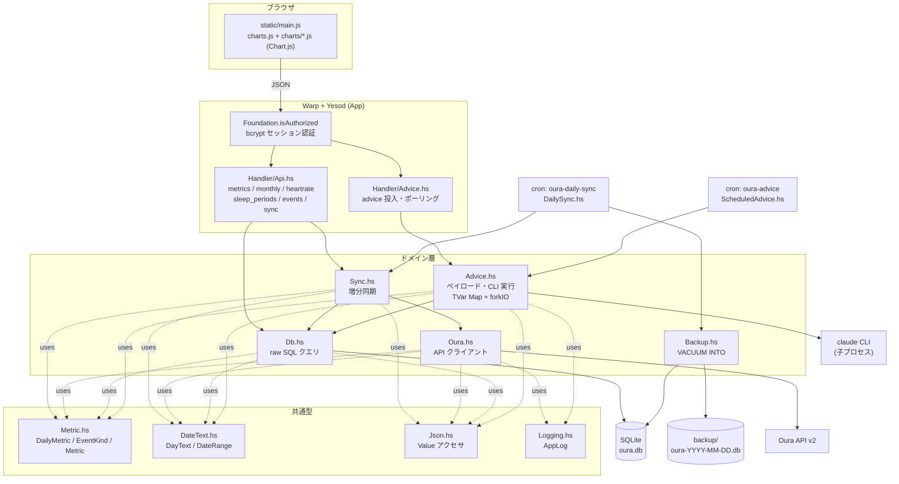
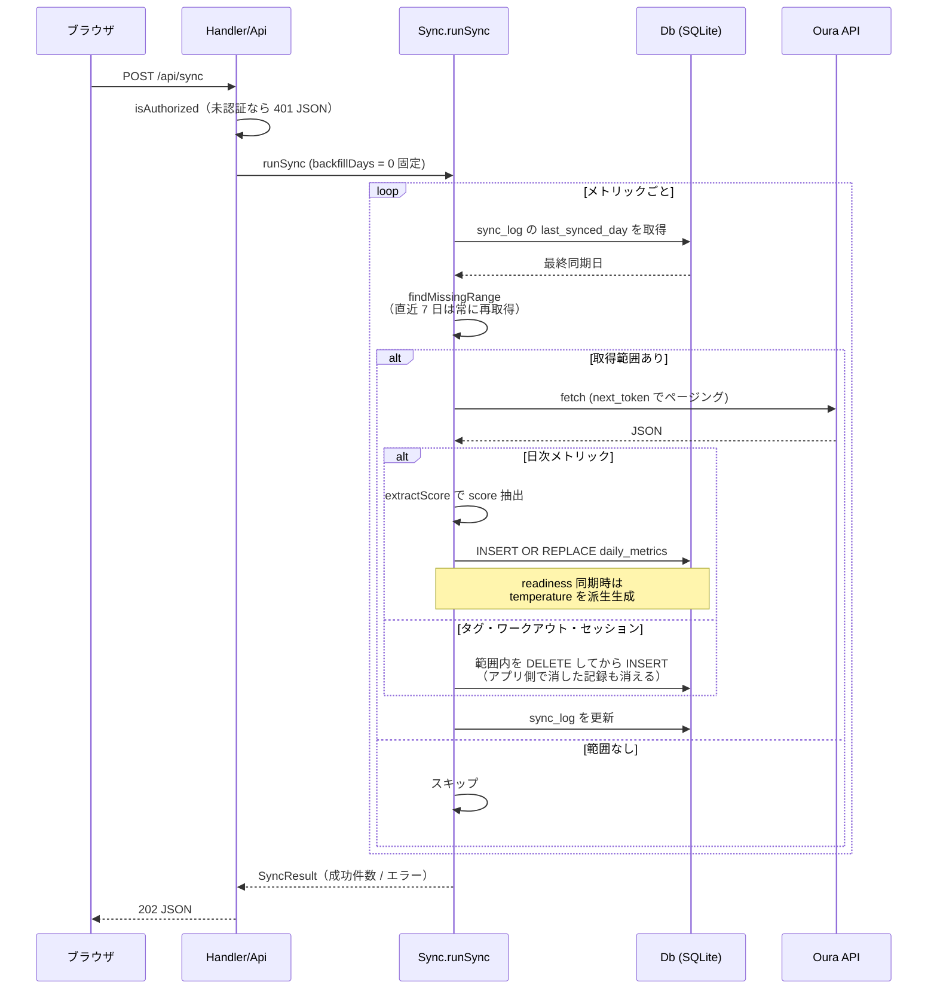
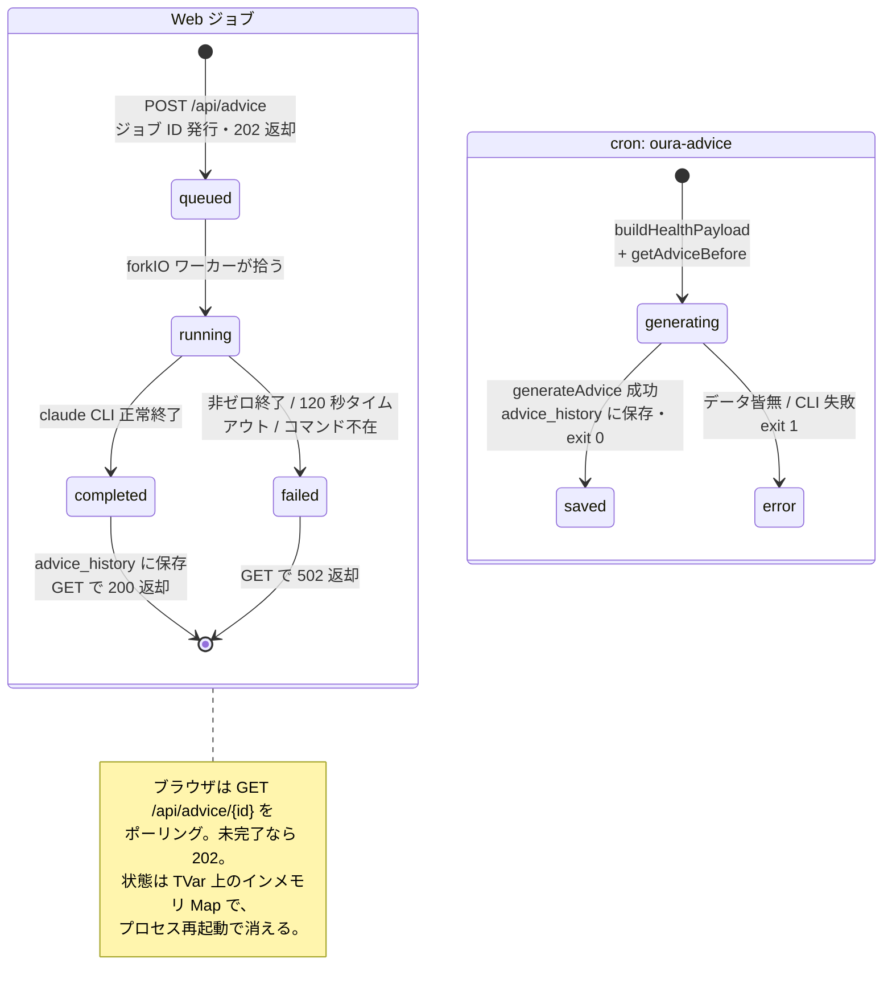
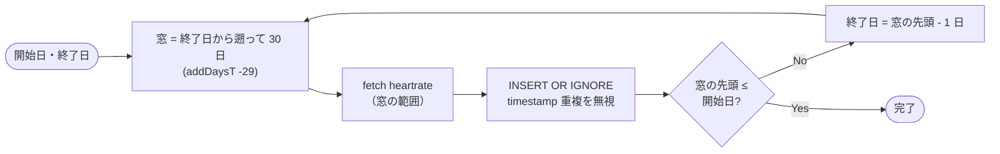

# oura-dashboard-hs コード全体の解説

> 最終更新: 2026-10-27（`5fc3f35` 時点）

## 1. これは何をするコードか

Oura Ring が計測した生体データ（睡眠・準備度・活動量・ストレス・SpO2・体温・心拍・レジリエンス・VO2 Max・心血管年齢）と、ユーザー自身の記録（タグ・ワークアウト・セッション）を、Oura API v2 からローカルの SQLite に取り込み、Chart.js 製の静的フロントエンドに JSON API で配信する、**ローカル完結型の Yesod (Haskell) Web アプリ**です。

Python/Flask 版 `oura-dashboard` からの移植で、**Python 版から引き継いだ JSON API はバイト単位で互換**に保たれています。その上で、睡眠段階（`/api/sleep_periods`）・月平均（`/api/monthly`）・タグ等のイベント（`/api/events`）の各 API は Haskell 版で追加したもので、`static/` 配下のフロントエンドもこれらを使う形で Python 版から大きく拡張されています。

加えて、`claude` CLI を子プロセスとして起動し、直近 14 日分のデータから日本語のヘルスアドバイスを生成する機能を持ちます。Web からの非同期ジョブと、cron から定期実行する CLI（`oura-advice`）の 2 経路があり、どちらも直前のアドバイスを踏まえて「前回からの変化」を書かせます。cron の日次同期（`oura-daily-sync`）は同期後に DB のバックアップも取ります。

### たとえるなら

このアプリは **「自宅にある個人用の健康カルテ棚」** です。

- **Oura API** = 病院の検査機関。問い合わせれば結果をくれるが、毎回聞くのは遅いし失礼
- **SQLite (`oura.db`)** = 手元のカルテ棚。一度もらった検査結果はここに綴じておく
- **`Sync.hs`** = カルテ係。棚を見て「この日の分がまだ無い」と気づいたところだけ検査機関に取りに行く（＝増分同期）
- **Handler 層** = 受付窓口。閲覧者の身分証（セッション）を確認してから棚の中身を出す
- **`Advice.hs`** = 顧問医。カルテと前回の所見を読んで新しい所見を書くが、時間がかかるので「後で取りに来てください」と整理券（ジョブ ID）を渡す。週に何度かは頼まれなくても往診に来る（`ScheduledAdvice`）
- **`Backup.hs`** = 毎晩カルテ棚の写しを取って倉庫にしまう係。検査結果は再発行してもらえるが、顧問医の所見は二度と手に入らないため
- **`Metric.hs` / `DateText.hs`** = カルテ棚のラベル規格。「メトリック名」「日付」はどこでも同じ書式・同じ語彙で扱う、という約束事をコンパイラに守らせる係

### 主要コンポーネント

| ファイル | 行数 | 役割 |
|---|---|---|
| `src/Oura.hs` | 151 | Oura API v2 クライアント。**fetch 関数を持つレコード型** (`OuraClient`) にすることで、テスト時にスタブへ差し替え可能。next_token ページネーション、15 秒タイムアウト、HTTP ステータスと例外を `OuraError` に正規化 |
| `src/Db.hs` | 460 | SQLite クエリ層。既存 Python スキーマとの 1:1 互換を保つため raw SQL 中心（`INSERT OR REPLACE` / `INSERT OR IGNORE`、`substr`、`json_extract`、`GROUP BY`）。イベントの置き換え保存、月平均の集計もここ。export リストなしで `module Db where` |
| `src/Sync.hs` | 364 | 増分同期の中核。`findMissingRange` / `backfillRanges` / `runSync`。心拍のみ 30 日窓で逆方向にループ |
| `src/Advice.hs` | 422 | アドバイス生成。ペイロード構築・プロンプト・`claude` CLI 実行（`generateAdvice`、120 秒タイムアウト）と、TVar 上のインメモリ Map + `forkIO` ワーカーによる Web 用ジョブ |
| `src/Metric.hs` | 121 | `DailyMetric` / `EventKind` / `Metric` 型。メトリック名を `dailyMetricName` / `eventKindName` に一元化。`allDailyMetrics = [minBound..maxBound]` で総当たりを保証 |
| `src/DateText.hs` | 87 | `DayText`（`YYYY-MM-DD` の newtype）と `DateRange`。`parseDayText` は外部入力向けの検証付き `Maybe` 版、`parseDay` は `Day` への変換で失敗時 `error`。`todayIn` / `todayUtc` |
| `src/Json.hs` | 42 | `Value` に対する `jsonLookup`/`jsonText`/`jsonDouble`/`jsonInt`/`jsonArray`。Oura API のペイロードと `data_json` を読むための共通ヘルパー |
| `src/Logging.hs` | 97 | `AppLog`（`LogLevel -> Text -> IO ()` を包んだ newtype）でプレーン `IO` から書けるログ出口を明示的に受け渡す |
| `src/Settings.hs` | 188 | `AppSettings`。`config/settings.yml` と環境変数（`BACKUP_DIR`/`BACKUP_KEEP` など）から読む |
| `src/Foundation.hs` | 235 | `App` 型、`isAuthorized` によるルート単位の認可（`routeAccess`）、CSRF、セッション Cookie |
| `src/LoginThrottle.hs` | 68 | ログイン失敗の IP 単位カウント（15 分で 5 回 → 拒否）。純粋な核と TVar の殻 |
| `src/Handler/Auth.hs` | 74 | ログイン画面（HTML フォーム）とログアウト |
| `src/Handler/Api.hs` | 164 | metrics、monthly、heartrate、sleep_periods、events、sync |
| `src/Handler/Advice.hs` | 109 | advice の POST / ポーリング / 履歴 |
| `src/DailySync.hs` | 82 | cron 用 CLI（`oura-daily-sync`）。JST の今日、7 日分 backfill、同期後に DB バックアップ、エラー時 exit 1 |
| `src/ScheduledAdvice.hs` | 76 | cron 用 CLI（`oura-advice`）。前景でアドバイスを生成して `advice_history` に保存、失敗時 exit 1 |
| `src/Backup.hs` | 59 | `VACUUM INTO` による日次バックアップと世代管理 |
| `src/Application.hs` | 250 | `.env` ロード → 設定 → コネクションプール作成 → migrate → Warp 起動 |
| `static/*.js` + `static/charts/*.js` | 約 3,100 | フロントエンド（main / charts / helpers / api / export と、ダッシュボードのセクションごとの `charts/` モジュール） |

### データモデル（`config/models.persistentmodels`）

- `daily_metrics` — `(metric, day)` を主キーとし、`score` と生 JSON (`data_json`)、`synced_at` を保持
- `heartrate` — `(timestamp, bpm, day)`。`day` は集計用の非正規化カラム
- `sync_log` — メトリックごとの `last_synced_day`/`last_synced_at`。増分同期の起点
- `advice_history` — 生成済みアドバイスの保存先。Oura から取り直せない唯一のデータで、バックアップの主目的
- `sleep_periods` — 睡眠期間ドキュメント。1 日に複数行（本睡＋仮眠）あるため、
  `(metric, day)` ではなく Oura の document id が主キー。`sleep_phase_5_min`
  を含む生 JSON を `data_json` に保持（Haskell 版で新設）
- `oura_events` — タグ・ワークアウト・セッション（`Metric.EventKind`）。`(kind, id)` が主キーで、
  `day` は開始日（タグなら `start_day`）。1 日に任意件数あり得る（Haskell 版で新設）

### ルート（`config/routes.yesodroutes`）

```
/                          ダッシュボード（静的 HTML。未認証は /login へ）
/login  /logout            ログイン画面（HTML フォーム）とログアウト
/api/metrics  /api/metrics/#Text
/api/monthly               全期間の月平均（期間指定なし）
/api/heartrate
/api/sleep_periods         睡眠段階チャート用（必要フィールドのみ返す）
/api/events                タグ・ワークアウト・セッション（kind ごと）
/api/sync  /api/sync/status
/api/advice/history/#Text  （順序上 advice/#Text より先に定義）
/api/advice                POST でジョブ投入
/api/advice/#Text          "history" とジョブ ID を同一ハンドラで文字列分岐
```

### 実行形態

| バイナリ | 起動元 | 役割 |
|---|---|---|
| `oura-dashboard-hs` | systemd（`systemd/`、`run_oura_dashboard.sh`） | Web サーバ |
| `oura-daily-sync` | cron（`run_daily_sync.sh`、1 日 3 回） | 増分同期 + 7 日 backfill + DB バックアップ（`BACKUP_DIR=backup/`） |
| `oura-advice` | cron（`run_advice.sh`、週 3 回） | 定期アドバイス生成 |

---

## 2. 図解

### 図 A: システム全体構成



### 図 B: 増分同期のシーケンス



### 図 C: アドバイス生成の 2 経路



### 図 D: 心拍取得の 30 日窓ループ

心拍だけは他のメトリックと異なり、Oura API がサンプル単位（1 日数百件）で返すため、期間を 30 日ずつに区切って**新しい方から古い方へ**遡ります（`Sync.syncHeartrateRange`）。



---

## 3. 各モジュール・関数のつながりと役割

### 型の基盤

- **`Metric.hs`** — `DailyMetric`（`Sleep`〜`VO2Max` の 9 種）、`EventKind`（`Tags`/`Workouts`/`Sessions`）、`Metric`（`Daily DailyMetric | HeartrateSeries | SleepPeriodSeries | EventSeries EventKind`）。`dailyMetricName`/`eventKindName`/`metricName` が DB・JSON API で共有する唯一の文字列表現を作る。`allDailyMetrics`/`allEventKinds` は `[minBound..maxBound]` で、新しい種類を追加すると `case` の非網羅で**コンパイルが落ちる**設計（`extractScore`, `fetchFn`, `eventDay`, `eventSummary` など）。日次テーブル以外の同期対象は `seriesMetrics` に集約され、`syncStatusMetrics`/`dashboardMetrics`/sync 本文のメトリック名解決がこれを共有する。
- **`DateText.hs`** — `DayText`（`Text` の newtype、`Ord` はテキスト順＝この書式ではそのまま日付順）と `DateRange { rangeStart, rangeEnd }`。`parseDayText` は外部入力（URL セグメント・クエリパラメータ・リクエスト本文）向けの検証で、形状（`\d{4}-\d{2}-\d{2}`、テキスト順＝日付順を保つため）と暦としての妥当性（`1999-13-45` を弾く）の両方を見る。`parseDay` は `Day` への実変換で、失敗時は `error`。外部入力は必ず `parseDayText` を通るため、`parseDay` に届く日付は DB・`formatDay`・検証済み入力のいずれかに限られる。
- **`Json.hs`** — Oura API のペイロードと `data_json` を読む共通アクセサ。`Sync`/`Db`/`Advice`/`Handler.*` が利用。
- **`Logging.hs`** — `AppLog`（`LogLevel -> Text -> IO ()` の newtype）。`Oura.OuraClient` の fetch 関数や `Advice.runAdviceJob` のような `forkIO`/プレーン `IO` の経路は `MonadLogger` を持てないため、ログ出口を値として明示的に受け渡す。Web サーバ・`DailySync`・`ScheduledAdvice` はそれぞれ自分の `LoggerSet` を作る（プロセスごとに別ファイルへ書くため、共有はしない）。

### ドメイン層

- **`Oura.hs`** — `OuraClient` は日次メトリックごとの `DateRange -> IO [Value]` フィールドに加え、`getHeartrate`/`getSleepPeriods`/`getEvents :: EventKind -> DateRange -> IO [Value]` を持つレコード。`realClient` が http-conduit で実装し、`next_token` を追って全ページを結合する。イベント系エンドポイント（`enhanced_tag`/`workout`/`session`）は `end_date` を排他的に扱う（1 日範囲だと空が返る）ため、終了日の翌日を渡している。非 2xx や通信失敗は `OuraError` として投げ、`Sync.tryOura` が捕捉する。テストではこのレコードをスタブに差し替える。
- **`Db.hs`** — Python 版 `db.py` の raw SQL を 1:1 移植した部分に、Haskell 版の追加分が乗っている。
  - `mergeRow` が `data_json` に `day`/`score` を上書きマージする（DB の `score` 列が優先、Python の `{**data, "day":..., "score":...}` と同じ）。`getDailyMetricsBulk` は `M.fromListWith (flip (++))` で (metric, day) 順の行を集約。
  - `mainSleepPeriod`（その日の本睡眠の選択：`long_sleep` 優先、なければ `late_nap` を除いた中で就床時間最長。`static/helpers.js` の `mainPeriod` と同じ規則）は、月平均でも使うため `Advice` からここへ移った。
  - **イベント**：`replaceEvents` は範囲内の同種イベントを `DELETE` してから `INSERT OR REPLACE` する。Oura アプリでタグを消すと次の取得結果から単に消えるだけなので、upsert だけでは残り続けてしまうため。`getEvents` は範囲に掛かるもの（タグは `start_day`〜`end_day` のどこかが範囲に入れば対象）を開始順に返し、セッションの 5 秒間隔系列（`heart_rate` など）は落とす。`getAllEvents` が kind 名をキーにまとめる。
  - **月平均**：`getMonthlyMeans` は全期間を対象に、日次メトリックのスコア・歩数・高ストレス時間（`monthlyDailySeries`）と、本睡眠の平均 HRV・最低心拍（`mainSleepPeriods` → `monthlySleepFields`）の月ごとの平均と日数を返す。`sleep_periods` の行は 5 分系列を含んで大きいため、必要なフィールドだけ SQL の `json_object`/`json_extract` で抜き出してからデコードする。
- **`Sync.hs`** — `findMissingRange`（増分範囲の決定）、`backfillRanges`（欠損日の穴埋め範囲。日次メトリックは `score IS NOT NULL` で判定し、系列系は日ごとの「埋まっている」概念がない（タグの無い日が普通）ので窓全体を取り直す）、`syncDailyMetric`（フェッチ→`extractScore`→upsert、readiness 同期時は温度を派生生成）、`syncEvents`（フェッチ→`replaceEvents`）、`runSync`（メトリックごとに `foldRanges` で順にフェッチしつつ、`OuraError` はそのメトリックのエラーとして記録し次のメトリックへ進む）。心拍だけ `syncHeartrateRange` が 30 日窓で逆順ループ。
- **`Advice.hs`** — 生成の核と Web ジョブ管理の両方を持つ。
  - `buildHealthPayload`（`advicePeriod` = 直近 `adviceDays`（14）日分を `getDailyMetricsBulk` で取得し `extractKeyFields` でメトリックごとに必要フィールドだけ抜粋。睡眠は段階時間の日次合計・本睡眠の時刻とバイタル・仮眠数、イベントは `eventSummary` で時刻を `HH:MM`、長さを分に整形して付ける）
  - `buildAdvicePrompt`（日本語システムプロンプト＋JSON。`getAdviceBefore` で得た直前のアドバイスがあれば、それを踏まえて「前回からの変化」の節を書かせる）
  - `adviceComparison`（レポート上部に出す主要スコアの「今回期間 vs 前回期間」の平均）、`hasHealthData`（データ皆無の判定）
  - `generateAdvice`（`claude -p ... --model opus` を `proc` + `readCreateProcessWithExitCode` で実行、120 秒 `timeout`。Web ジョブと `ScheduledAdvice` で共有）
  - `createAdviceJob`（UUID 発行、`TVar (Map Text AdviceJob)` に `Queued` で登録）→`runAdviceJob`（`forkIO` 済みの別スレッドで `generateAdvice` を呼び、成功時は `advice_history` に保存）
- **`Backup.hs`** — `backupDatabase` は `VACUUM INTO` で `oura-YYYY-MM-DD.db.partial` に書き出してからリネームする（クラッシュしても途中までのファイルが `oura-*.db` として残らない）。SQLite 自身が一貫したスナップショットを書くので、Web サーバやアドバイスジョブが書き込み中でも安全。`VACUUM` はトランザクション内では失敗するため `runSqlPoolNoTransaction` を使う。同じ日の再実行は上書きし、`staleBackups` で新しい `backup-keep`（既定 14）世代だけ残す。`backup-dir` が空（既定）ならバックアップしない（複製 DB での開発実行が本物のバックアップを上書きしないように）。

### Handler 層

- **`Foundation.hs`** — `App` レコード（DB プール、静的ファイル設定、`OuraClient` のテスト用差し替え口、advice ジョブ状態、`AppLog`、ログイン制限など）。`isAuthorized` が `routeAccess` でルートを分類し、未認証なら `/` は `/login` へリダイレクト、`/static/*` は 404、`/api/*` は 401 JSON を返す（`routeAccess` はワイルドカードなしで、新ルートは分類を強制される）。セッション Cookie は `SameSite=Lax`、`defaultCsrfMiddleware` で CSRF トークンを照合する。`checkPassword` は bcrypt 検証。
- **`Handler/Auth.hs`** — `getLoginR`/`postLoginR`/`postLogoutR`。ログイン画面は `templates/login.hamlet` を `withUrlRenderer` で直接描画する（`defaultLayout` は CSS を `/static/tmp` に書き出し、未認証では読めないため使わない）。失敗回数は `LoginThrottle` で IP ごとに数える。
- **`Handler/Api.hs`** — `getMetricsR`/`getMetricR`（`parseRange` でクエリパラメータから `DateRange` を組み立て、`Db.getDailyMetrics(Bulk)` を呼ぶ。既定は直近 30 日）、`getMonthlyR`（期間指定なしで `Db.getMonthlyMeans`）、`getHeartrateR`、`getSleepPeriodsR`、`getEventsR`（`Db.getAllEvents`）、`getSyncStatusR`、`postSyncR`（`appOuraClientOverride` があればそれを使い、なければ `OURA_TOKEN` から `realClient` を構築して `Sync.runSync` を実行、`backfillDays = 0` 固定）。日付を受け取る入口（`parseRange` のクエリパラメータ、sync 本文の `start`/`end`）はいずれも `requireDayText` を通し、不正な日付は 400 で弾く。`jsonBodyOrEmpty` は `parseCheckJsonBody` の結果を見て、パース失敗時だけ空オブジェクトにフォールバックする。
- **`Handler/Advice.hs`** — `postAdviceR`（14 日分のペイロードと直前のアドバイスを取り、データが皆無なら 400、そうでなければ `adviceComparison` 付きのジョブを作って `forkIO` で起動し 202 を返す）、`getAdviceJobR`（`seg == "history"` かジョブ ID かを文字列で分岐）、`adviceJobStatus`（ジョブの状態に応じて 200/502/202）、`getAdviceEntryR`（`parseDayText` で日付形式を検証してから履歴を引く）。
- **`Handler/Home.hs`** / **`Handler/Common.hs`** — 静的な `index.html`・favicon・robots.txt の配信。

### エントリポイント

- **`Application.hs`** — `.env` ロード→`AppSettings` 読み込み→`SECRET_KEY` 必須チェック→ロガー2系統（アプリ用 `appLogger`/`appPlainLogger`、アクセスログ用 `appAccessLoggerSet`）の初期化→DB プール作成→`migrateAll`→Warp 起動。`static/*` と `index.html` は `revalidating` で `Cache-Control: no-cache` 配信。`app/main.hs`（本番）と `app/devel.hs`/`DevelMain.hs`（開発）から呼ばれる。
- **`DailySync.hs`** — cron から `app-daily-sync/main.hs` 経由で実行される CLI。JST の「今日」（`todayIn (hoursToTimeZone 9)`）を基準に 7 日分の backfill 付きで `runSync` を呼び、続けて `backupDatabase` を実行する。バックアップは同期が失敗しても行う（守りたいのは同期と無関係な `advice_history` のため）。同期エラーかバックアップ失敗のいずれかがあれば `exitWith (ExitFailure 1)`。
- **`ScheduledAdvice.hs`** — cron から `app-advice/main.hs` 経由で実行される CLI。JST の今日を終端に Web のボタンと同じ 14 日分でアドバイスを生成し、`advice_history` に保存する（履歴一覧に並ぶ）。ジョブ機構は使わず前景で実行し、データ皆無や CLI 失敗は exit 1。cron が `LANG` なしで起動しても `claude` の日本語入出力を扱えるよう、冒頭でエンコーディングを UTF-8 に固定する。日次同期の後に走らせる前提。

### フロントエンド

- `static/main.js` — 画面制御（期間プリセット・カスタム期間、同期、アドバイス、チャートの全画面表示など）
- `static/charts.js` — Chart.js 描画の入口。`renderAll` が `charts/` 配下のモジュールを呼ぶ
  - `common.js`（共通部品・色・日付ヘルパー）、`baseline.js`（7 日移動平均・28 日ベースライン）、`cards.js`
  - `scores.js`（スコア推移と内訳ヒートマップ）、`sleep.js`、`vitals.js`、`stress.js`、`activity.js`
  - `correlation.js` — 就床時刻×睡眠スコアの散布図、曜日平均に加え、「その日の歩数・中高強度活動・高ストレス時間・就床時刻」と「翌朝の Readiness・HRV」を突き合わせる翌日相関（`nextDayPoints`）
  - `events.js` — タグ・ワークアウト・セッションの一覧と、タグ（およびワークアウト）ごとの翌朝のスコア・HRV の平均（`tagLabel` がタグコードを表示名に変換）
  - `longterm.js` — `/api/monthly` による全期間の月平均。選択期間とは無関係で、日数の少ない月は中抜きの点で描く
- `static/helpers.js`（共通関数、`mainPeriod` など）・`api.js`（`apiFetch` ラッパー、401 時にログインモーダルを出す）・`export.js`（表示中期間の CSV 生成）
- Chart.js と markdown ライブラリは `static/vendor/` から配信（CDN 非依存）

---

## 4. 潜在的な改善点

実害が大きいと思われる順に挙げます。**静的読解による判断で、再現テストは未実施です。** 前回のレビュー以降に解消された項目は末尾にまとめています。

### 中: 「今日」の基準がモジュール間で不一致

`Handler.Api` の `parseRange`/`postSyncR` と `Handler.Advice.postAdviceR` は `DateText.todayUtc` を、`DailySync`/`ScheduledAdvice` は JST（`todayIn (hoursToTimeZone 9)`）を使う。JST 深夜帯（0:00〜9:00）では両者が指す日付が 1 日ずれるため、Web からの同期と cron からの同期で対象範囲が食い違うほか、Web のアドバイスボタンと定期アドバイスで分析期間（14 日窓）の終端が変わる。どちらかに統一すべき。

### 中: アドバイスジョブが無制限に蓄積する

`Advice.AdviceJobs`（`TVar (Map Text AdviceJob)`）から完了・失敗ジョブを回収する仕組みがない。長時間稼働でメモリが単調増加する（定期アドバイスはこの Map を使わないので影響しない）。Python 版も同じ構造だが、移植先で TTL 付き削除を入れられる。

### 低: `getDailyMetricsBulk` の集約が O(n²) になりうる

`Db.getDailyMetricsBulk` は `M.fromListWith (flip (++))` で行を集約するが、`flip (++) new old = old ++ new` は毎回 `old` 全体をたどるため、1 メトリックあたりの行数の二乗に比例する。14〜30 日分なら無害だが、カスタム期間で数年分を指定すると劣化する。逆順に積んで最後に `reverse` するか `Data.Sequence` を使えば線形になる。（同じ書き方の `mainSleepPeriods` はキーが日なので 1 キーあたり数行で、問題にならない。）

### 低: `/api/monthly` は毎回全履歴を集計する

`Db.getMonthlyMeans` はリクエストごとに `daily_metrics` と `sleep_periods` の全行を走査し、`json_extract` で値を取り出す。個人の数年分なら問題ないが、ダッシュボードを開くたびに走るので、データが増えて重くなったら同期時に月次集計を保存する形にできる。

### 低: advice ルートが URL の文字列比較で分岐している

`/api/advice/#Text`（`AdviceJobR`）が `"history"` かジョブ ID かを `Handler.Advice.getAdviceJobR` 内の文字列比較で判定している。ジョブ ID は UUID なので実害はないが、ルート定義を分けたほうが堅牢。

### 低: Web 経由の sync だけ backfill が働かない

`Handler.Api.postSyncR` は `Sync.runSync ... 0`（`backfillDays = 0` 固定）で、欠損日のバックフィルは `DailySync`（cron、`backfillDays = 7`）のみが担う。意図的な設計と思われるが、非対称なので挙動を把握していないと「Web から同期したのに古い欠損が埋まらない」と混乱する。

### 低: `src/Db.hs` に export リストがない

`module Db where` なので内部ヘルパーも全公開。イベント・月平均の追加で 460 行になり、他モジュールとの契約がさらに見えにくくなっている。

### 低: ログ言語が層によって混在

`Sync.hs`/`Oura.hs`/`Advice.hs` のログ行自体は英語だが、`Advice.generateAdvice` が返す失敗メッセージはユーザー向け日本語文言で、`runAdviceJob` の `fail'` と `ScheduledAdvice` の `"scheduled advice failed: "` がそれをそのままログにも書いている。ユーザー向け応答と内部ログを同じ文字列で兼用しているため、ログを追う際に言語が混在する。

### 確認済み・問題なし

- `oura.db` / `*.sqlite3` / `config/client_session_key.aes` / `.env` / `backup/` はいずれも `.gitignore` 済みで、リポジトリには含まれていない。
- `generateAdvice` は `proc` で `claude` CLI を起動しており（シェル経由ではない）、コマンドインジェクションの余地はない。プロンプト内容は DB 由来（タグの自由入力名・コメントもユーザー本人の入力）。
- バックアップの `VACUUM INTO ?` はパスをプレースホルダで渡しており、ディレクトリ名に記号が含まれても SQL として解釈されない。

### 前回レビュー以降に解消された項目

- **「日付パースが `error` を呼び 500 クラッシュしうる」（旧・高）** — `DateText.parseDayText` に暦としての妥当性検証を追加し、`Handler.Api.requireDayText` が `parseRange` のクエリパラメータと sync 本文の `start`/`end` の両方を、`Handler.Advice.getAdviceEntryR` が履歴の日付を検証して失敗時に 400 を返すようになったことで解消。外部から入った `DayText` は必ず `parseDay` でパースできる。
- **「`parseBodyOr` が `SomeException` を握り潰す」（旧・中）** — コミット `1d698e2`/`8b206e7` で `Handler.Api.jsonBodyOrEmpty` が `parseCheckJsonBody` の結果を見てパース失敗時のみフォールバックする実装に変更され、非同期例外を含む無関係な例外まで飲み込む問題は解消。
- **メトリック名・日付・グローバルロガーが文字列/暗黙状態だった問題** — コミット `1835052` で `Metric.hs`、`DateText.hs`、`Logging.hs` に型化され、ディスパッチの網羅性がコンパイル時に保証されるようになった。
